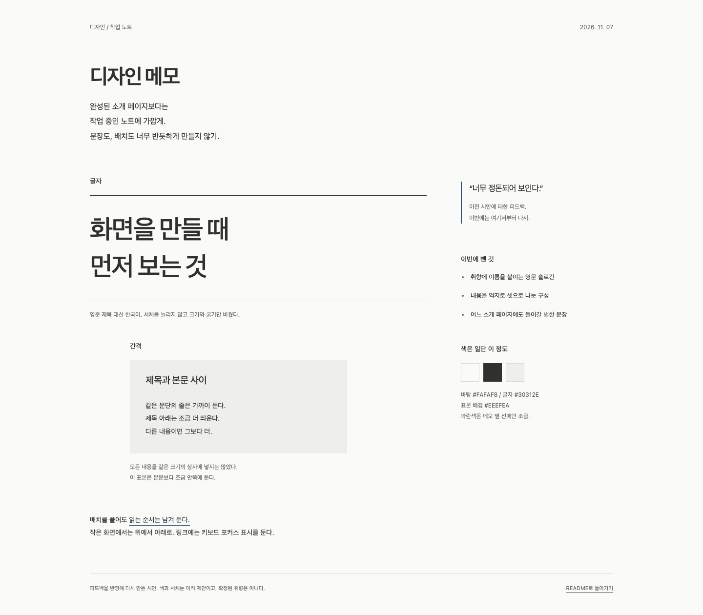

# DESIGN MCP

새 프로젝트를 만들거나 기존 프로젝트를 업데이트할 때, 필요한 디자인 패턴을 찾아 적용하도록 돕는 **읽기 전용 MCP 서버**입니다. 범용 UI/UX·시각 스타일·모션·차트·3D 설계 지침, 대표 SwiftUI/웹 예제, WEASHION 프로젝트 참조를 구분합니다.

문서 전체를 매번 컨텍스트에 넣는 대신 **카테고리 → 짧은 검색 결과 → 선택한 패턴 → 적용 가이드** 순서로 가져옵니다. 원본 코드 발췌는 필요한 경우에만 조회합니다.

## 디자인 메모

너무 반듯한 소개 페이지보다는 작업 노트에 가깝게.



영문 슬로건과 세 칸짜리 원칙은 뺐다. 한국어 글자, 간격 표본, 옆에 붙인 메모로 다시 만들었다. 배치를 조금 풀되 읽는 순서는 유지했다.

[HTML/CSS 소스](./docs/aesthetic.html)를 내려받아 브라우저에서 열 수 있다. 외부 폰트나 스크립트는 쓰지 않았다. GitHub README에서는 CSS가 적용되지 않아 PNG로 올렸다.

색과 서체는 아직 시안이다. 라이브러리 전체의 스타일을 정한 것은 아니다. 페이지를 수정하면 1440px 너비에서 전체를 캡처해 미리보기도 갱신한다.

[강한 색감의 화면 예시](./docs/high-energy.html)도 따로 만들었다. 가상의 야간 러닝 이벤트를 주황·먹색·라임, 큰 숫자와 트랙 그래픽으로 구성한 HTML/CSS 페이지다. 실제 모집 페이지는 아니다.

색에 따른 분위기를 비교하려면 [색 조합 문서](./docs/color-combinations.md)와 [HTML 비교 화면](./docs/color-combinations.html)을 보면 된다. 같은 화면에 여덟 가지 팔레트를 적용했고 색 코드·용도·주의점을 함께 적었다. MCP 카탈로그와 별도로 관리하는 문서용 예시다.

[분위기별 화면 모음](./docs/mood-examples.html)에는 독서·음악·여행·전시·작업 도구·카페 예시를 추가했다. 각 화면에서 세 가지 배색을 선택할 수 있다. [추가 배색 18가지](./docs/mood-examples.md)를 포함해 총 26가지 색 조합을 비교한다.

## 제공 범위

[검정 미니멀 예시](./docs/black-minimal.html)는 검정·차콜·회색의 파일 보관함 화면이다. 검색·파일 선택·페이지 내 고정이 작동하며 실제 파일 접근이나 영구 저장은 없다. MCP에서는 `get_design_visual`의 `id=black-minimal`로 조회한다.

[검정 포스터형 시안](./docs/black-editorial.html)은 공유한 레퍼런스의 큰 번호·얇은 타이포·수평 구획·붉은 빛을 참고해 별도로 만들었다. 작업 설명은 아코디언으로 열 수 있다. 220–480ms의 진입·펼침, 작은 호버 이동, 마우스에 반응하는 빛(가로 최대 14px·세로 10px)을 적용했다. 상단에서 효과를 끌 수 있고 OS 모션 감소 설정을 우선하며, 숨겨진 탭에서는 중지한다. 반복 재생·스크롤 강제 이동은 없으며 JavaScript 없이도 내용과 아코디언을 사용할 수 있다. 원본 자산이나 문구를 복제하지 않은 가상 포트폴리오이며 MCP ID는 `black-editorial`이다.

[스포츠 사진 콜라주](./docs/sports-collage.html)는 흰 여백·가로 사진 구획·얼굴 확대·프레임을 넘는 인물을 조합한 가상 지면이다. CC0 사진과 수동 SVG 윤곽을 사용하며 대각선 화살표는 없다. 참고 원본은 권한 미확인으로 링크만 기록했다. [사진 출처·사용 조건](./docs/sports-collage.md)을 확인하고 HTML과 `docs/assets/sports-soccer-cc0.jpg`를 함께 보관한다. MCP ID는 `sports-collage`이며 사진 바이너리는 HTML 조회로 전달하지 않는다.

[복싱 레퍼런스별 시안](./docs/boxing-references.md)은 [위에서 본 링](./docs/boxing-overhead.html), [종이 질감 포스터](./docs/boxing-vintage.html), [조명 아래 뒷모습](./docs/boxing-arena.html) 세 가지다. 각 링크의 구성·색을 독자적인 SVG 일러스트로 해석했다. 외부 자산·원본 사진·대각선 화살표 없이 열린다. MCP ID는 `boxing-overhead`, `boxing-vintage`, `boxing-arena`이다.

화면 효과는 [HTML 갤러리](./docs/screen-effects.html)에서 32개를 직접 실행·초기화·정지하며 비교할 수 있다. [효과 목록 문서](./docs/screen-effects.md)에는 기존 패턴 연결, 보충한 효과 종류, 웹에서 재현하지 않은 네이티브·3D 항목의 한계도 적었다. 아래 MCP 집계와는 별도의 문서용 자료다.

- **36개 카테고리, 186개 패턴**: 범용 지침 22개 카테고리·138개 패턴 + 기존 WEASHION 14개 카테고리·48개 패턴.
- 기존 원본 코드 블록 **57개 보존** + 대표 패턴 10종의 **SwiftUI 10개·웹 10개 예제**.
- 한국어·영어 키워드 검색, 카테고리·출처·플랫폼별 예제 유무 필터와 페이지 단위 조회.
- 패턴별 범용 원칙, 플랫폼별 적용 지침, 원본 의존성·구현 상태·주의사항·검증 기준.
- 신규 프로젝트 설계와 기존 프로젝트 개선을 구분한 적용 가이드.
- MCP Tools **6개**, Resources **241개**(카탈로그 1 + 패턴 186 + 가이드 37 + 시각 예시 인덱스 1 + HTML·문서 16), Prompts 2개.
- 별도 시각 예시 11종: 복싱 3종, 스포츠 콜라주, 검정 포스터형, 검정 미니멀, 개인 작업 노트, 러닝 이벤트, 8가지 배색, 분위기별 18가지 배색, 32개 화면 효과. `search_design_visuals`와 `get_design_visual`로 조회.
- 원본 저장소나 개발자 컴퓨터의 절대 경로가 필요 없는 패키지.
- 런타임 외부 API·LLM·검색 서비스·벡터 DB·API 키 없이 로컬 실행.

**이 서버는 대상 프로젝트를 읽거나 수정하지 않습니다.** 연결된 AI가 대상 코드를 조사하고, 지침을 선택적으로 적용하고, 테스트합니다. MCP가 반환한 계획은 실제 분석·수정·검증 완료를 의미하지 않습니다.

전체 범용 카테고리와 대표 예제 목록은 [범용 라이브러리 안내](./docs/general-library.md)에 있습니다. 모든 디자인을 망라한 사전이나 완제품 UI 킷은 아닙니다. 패턴별로 **사용·피해야 할 상황, 구조, SwiftUI/웹 적용, 접근성, 검증, 주의사항**을 제공합니다.

### SwiftUI와 웹의 차이

| 대상 | 제공하는 것 | 제공하지 않는 것 |
| --- | --- | --- |
| `swiftui` | 전체 원칙·지침, 선택한 범용 예제, 기존 프로젝트 발췌 | 완제품 컴포넌트 킷, iOS 앱·실기기 실행 보장 |
| `web` | 전체 원칙·지침, 선택한 HTML/CSS/JavaScript 예제 | React/Next.js/Three.js 전용 구현, SwiftUI 자동 변환 |
| `agnostic` | 플랫폼에 종속되지 않은 원칙과 검증 기준 | 플랫폼 공통 실행 코드 |

예를 들어 **700pt는 원본 프로젝트의 열 전환 기준**이지 모든 앱이나 웹에서 사용할 규칙이 아닙니다. 대상의 콘텐츠, 글씨 크기, 기존 토큰과 테스트를 기준으로 다시 결정합니다. 버건디·서체·타이밍·브랜드 자산도 강제하지 않습니다.

## 빠른 시작

Node.js **22 이상**과 npm이 필요합니다.

```bash
npm ci
npm test
```

테스트 과정에서 빌드도 수행합니다. 개발 시에는 다음 명령을 개별 실행할 수 있습니다.

```bash
npm run build
npm run typecheck
```

MCP 실행 진입점은 빌드된 `dist/index.js`입니다. 터미널에서 직접 실행하면 stdin/stdout 프로토콜 요청을 기다리므로 일반 CLI처럼 결과를 바로 출력하지 않습니다. **MCP 클라이언트가 프로세스를 실행하도록 연결**합니다.

`npm start`도 개발용으로 사용할 수 있지만, MCP 설정에는 npm의 부가 출력을 피할 수 있는 `node` 진입점 또는 설치된 `design-mcp` 명령을 권장합니다.

## 여러 프로젝트에서 사용하기

### 권장: 패키지 한 번 설치 후 사용자 범위에 등록

이 방식은 각 프로젝트에 DESIGN이나 WEASHION을 복사하지 않아도 됩니다.

1. 이 저장소에서 패키지의 설치·실행까지 검증합니다.

   ```bash
   npm run verify:package
   ```

   생성 결과는 `acertainromance401-design-mcp-0.3.0.tgz`입니다. 별도 임시 디렉터리에 설치한 뒤 실제 stdio MCP 요청으로 범용 웹 예제와 시각 예시 11종의 HTML 조회까지 확인합니다. 임시 설치는 검증 후 정리합니다.

2. 검증한 패키지를 한 번 설치합니다. 경로는 실제 생성 위치로 바꿉니다.

   ```bash
   npm install --global /absolute/path/to/acertainromance401-design-mcp-0.3.0.tgz
   ```

3. VS Code 명령 팔레트에서 **MCP: Add Server → Command (stdio)**를 선택하고 `design-mcp`를 등록합니다. 현재 VS Code에서 제공하는 **Global/사용자 범위** 저장 위치를 선택하면 여러 프로젝트에서 공유할 수 있습니다.

4. 서버 시작·신뢰 확인 후 도구 목록에서 `list_design_categories`를 호출해 36개 카테고리와 출처별 패턴 수(WEASHION 48, 범용 138)가 반환되는지 확인합니다.

이 패키지는 **npm 레지스트리에 게시하지 않았습니다.** 아직 공개 패키지명을 이용한 `npx` 설치를 전제로 하지 않습니다. 위 tarball을 다른 컴퓨터에 전달해 설치할 수 있으며, 최초 설치에는 선언된 npm 의존성을 받기 위한 네트워크 연결이 필요할 수 있습니다. 서버 실행 중에는 네트워크를 사용하지 않습니다.

전역 설치 명령을 VS Code가 찾지 못하면 GUI 프로세스의 PATH를 확인하거나 아래의 직접 실행 방식을 사용합니다. 패키지를 교체한 뒤에는 MCP 서버를 재시작합니다.

### 개발용: 로컬 빌드를 직접 연결

VS Code의 사용자 범위 MCP 설정 또는 대상 프로젝트의 `.vscode/mcp.json`에 추가할 수 있습니다. 기존 설정이 있으면 `servers` 항목을 병합하고 덮어쓰지 않습니다.

```json
{
  "servers": {
    "design": {
      "type": "stdio",
      "command": "node",
      "args": ["/absolute/path/to/DESIGN/dist/index.js"]
    }
  }
}
```

이 경로는 **DESIGN의 빌드 진입점**이며 WEASHION의 경로가 아닙니다. 작업 디렉터리가 어떤 프로젝트이든 지식은 패키지 위치를 기준으로 읽습니다.

- VS Code 입력 변수 방식: [설정 예제](./examples/vscode-mcp.json)
- `mcpServers` 형식을 사용하는 다른 클라이언트: [일반 클라이언트 예제](./examples/generic-mcp.json)

다른 클라이언트에서는 해당 제품이 요구하는 MCP 설정 형식에 맞춥니다. 서버는 표준 stdio MCP를 사용하며 특정 AI 서비스에 종속되지 않습니다.

## 도구 계약

### 시각 예시 조회 (0.3.0 추가)

기존 패턴 검색과 구분해 배색·분위기별 화면·효과 갤러리를 조회합니다. `list_design_categories`의 `visualExamples`와 `design://visual-examples`에서 11종의 ID·키워드·리소스 URI를 확인합니다.

```json
{"query":"배색 카페","limit":5,"offset":0}
```

위 인자로 `search_design_visuals`를 호출합니다. `query`는 공백 제외 1~200자, `limit`은 1~10(기본 5), `offset`은 0~1000입니다. 결과는 `total`, `nextOffset`, `results`이며 메타데이터와 문서의 결정적 키워드 검색입니다. HTML 전체는 검색 결과에 넣지 않습니다.

```json
{"id":"screen-effects","includeSource":true}
```

위 인자로 `get_design_visual`을 호출합니다. 기본 `includeSource=false`는 요약·한계·문서·리소스 링크만 반환하며, `true`는 HTML/CSS/JavaScript 소스를 추가합니다. 지원 ID는 `boxing-overhead`, `boxing-vintage`, `boxing-arena`, `sports-collage`, `black-editorial`, `black-minimal`, `aesthetic-notes`, `high-energy`, `color-combinations`, `mood-examples`, `screen-effects`입니다. 스포츠 콜라주는 패키지에 포함된 사진 파일도 함께 필요합니다.

`htmlUri`와 `guideUri`는 `design://visual-files/<파일명>` 리소스입니다. 문서의 로컬 링크는 등록된 시각 파일 리소스 또는 원본 GitHub 링크로 변환됩니다. **MCP는 HTML 텍스트를 반환할 뿐 실행·렌더링하지 않습니다.** 브라우저에서 보려면 HTML을 파일로 저장해 엽니다. HTML 내부의 상대 문서 링크까지 사용할 때는 원본 저장소 구조를 유지하거나 MCP의 문서 리소스로 조회합니다.

로컬 빌드를 사용하는 MCP는 빌드 후 재시작합니다. 설치된 패키지를 사용하는 MCP는 0.3.0 tarball로 교체한 뒤 재시작합니다. 이 시각 예시는 웹 데모이며 네이티브 앱 컴포넌트나 햅틱·실기기 품질 보장이 아닙니다.

### `list_design_categories`

입력은 빈 객체 `{}`입니다. 카테고리 ID·제목·키워드·패턴 수·`sourceKind`·리소스 URI, `sources`와 `sourceCounts`를 반환합니다. 기존 `source` 필드는 WEASHION 기준을 유지합니다. 전체 문서와 코드를 한 번에 반환하지 않습니다.

### `search_design_patterns`

```json
{
  "query": "모달 dialog",
  "category": "overlays",
  "platform": "web",
  "source": "general",
  "hasExample": true,
  "limit": 4,
  "offset": 0
}
```

- `query`: 공백 제외 1~200자. 짧은 한국어·영어 키워드를 권장합니다.
- `category`: 선택한 카테고리 ID. 생략하면 전체에서 찾습니다.
- `platform`: `swiftui` / `web` / `agnostic`. 기본 `swiftui`.
- `source`: `all`(기본) / `weashion` / `general`. 기존 참조만 필요하면 `weashion`.
- `hasExample`: 선택 사항. `true`는 선택한 플랫폼의 코드가 실제 있는 패턴만, `false`는 없는 패턴만 조회합니다. `agnostic`에는 실행 예제가 없습니다.
- `limit`: 1~10, 기본 6. `offset`: 0~1000, 기본 0.
- 결과: `results`, `total`, `offset`, `nextOffset`. 각 결과는 안정적인 `id`, 원칙, 출처 종류, 구현 상태, 예제 유무와 URI를 포함합니다. 모든 필터는 정렬·페이지 분할 전에 적용됩니다.

검색은 **가중 키워드 검색**입니다. ID·제목·패턴 키워드, 원칙·카테고리, 본문 순으로 가중치를 부여하고 하나 이상의 단어가 일치하는 결과를 정렬합니다. 벡터·의미 검색이나 신뢰도 점수가 아닙니다. 무관한 요청에는 빈 결과를 반환하며 임의 패턴으로 대체하지 않습니다.

### `get_design_pattern`

```json
{
  "id": "overlay.modal-dialog",
  "platform": "web",
  "includeSourceExample": true
}
```

- `id`: 검색으로 찾은 패턴 ID. 원문 번호나 파일 위치가 바뀌어도 ID는 가능한 한 유지합니다.
- `includeSourceExample`: 기본 `false`. 요약·원칙·의존성·검증 기준만 먼저 조회해 컨텍스트를 줄입니다.
- 범용 패턴은 `guidance`에 사용·회피 조건, 구조, 접근성, 관련 패턴을 제공합니다.
- `true`이면 선택한 플랫폼의 범용 예제가 있을 때 코드를 제공합니다. `example`에는 요구사항·검증 수준·한계가 표시됩니다.
- WEASHION 발췌는 기존처럼 SwiftUI 대상으로만 제공합니다. 웹 코드로 이름을 바꾸지 않습니다.
- `agnostic` 또는 해당 플랫폼 예제가 없는 패턴은 코드를 생략하고 `sourceExampleNotice`에 이유를 명시합니다.

WEASHION의 `sourceImplementationStatus`는 `documented`, `documented-with-limitations`, `defined-not-connected`, `reference`, `inventory` 중 하나입니다. **원문이 기록한 상태**이지 앱을 새로 실행해 확인한 상태가 아닙니다. 범용 패턴은 `guidance`이며 예제의 유무·검증 수준은 별도 필드입니다.

원본 08번의 문자 교체는 `defined-not-connected`로, 접근성 분기 한계가 있는 실행 스플래시는 `documented-with-limitations`로 구분합니다. 코드를 복사하기 전에 `sourceDependencies`, `cautions`, `validationChecklist`를 확인합니다.

### `create_design_adoption_plan`

```json
{
  "objective": "기존 앱에서 큰 글씨와 좁은 화면의 배치를 개선",
  "projectType": "existing",
  "platform": "swiftui",
  "patternIds": ["layout.content-width", "input.focus-and-validation"]
}
```

- `objective`: 공백 제외 1~1000자.
- `projectType`: `new` 또는 `existing`.
- `patternIds`: 선택 사항, 최대 8개. 검색 후 명시적으로 선택하는 방식을 권장합니다.
- `categoryIds`: 선택 사항, 최대 6개. 명시한 패턴과 충돌하면 오류입니다.
- `source`: 검색과 같은 출처 필터. 명시한 `patternIds`와 충돌하면 `SOURCE_CONFLICT` 오류입니다.
- 패턴 ID를 생략하면 목적 전체를 키워드 검색한 뒤 카테고리 필터 내 최대 6개를 선택합니다.
- 결과가 없으면 명시적 오류를 반환합니다. 다른 카테고리의 패턴을 임의로 넣지 않습니다.

기존 프로젝트는 **현재 토큰·컴포넌트·상태·테스트와 사용자 변경 조사 → 보존할 동작 확인 → 선택적 매핑 → 구현·검증** 순서를 따릅니다. 신규 프로젝트는 먼저 화면 목적·주요 행동·최소 플랫폼·접근성을 정합니다.

모든 도구는 읽기 전용이며, 결과는 MCP 텍스트와 `structuredContent`로 제공합니다. 잘못된 입력은 스키마 오류로, 알 수 없는 패턴·카테고리나 충돌은 `isError: true`와 오류 코드로 전달합니다.

## 실제 요청 예

연결한 AI에 다음과 같이 요청합니다.

**새 SwiftUI 프로젝트**

> DESIGN MCP에서 색상·서체·반응형 패턴을 찾아줘. 내 앱 목적에 맞게 원칙을 선택하고 신규 프로젝트 적용 가이드를 만든 뒤 구현해줘. WEASHION의 색상과 700pt를 그대로 강제하지 말고 접근성 테스트도 해줘.

**기존 SwiftUI 프로젝트**

> 기존 컴포넌트와 토큰을 먼저 확인해줘. DESIGN MCP의 입력 오류·저장 피드백 패턴을 참고하되 기존 동작을 유지하면서 개선하고 실제 성공·실패·취소 상태를 검증해줘.

**웹 프로젝트**

> DESIGN MCP에서 source=general, platform=web으로 반응형과 모션을 찾아줘. 실제 코드가 필요하면 hasExample=true로 검색하고 선택한 예제의 요구사항과 한계를 확인해줘. 우리 프로젝트의 컴포넌트 체계를 유지하면서 키보드 접근·확대·동작 줄이기를 검증해줘.

MCP 연결만으로 자동 적용을 보장하지는 않습니다. 클라이언트에서 서버와 도구가 활성화돼 있어야 하며, 실제 도구 호출과 프로젝트 변경은 연결된 AI가 수행합니다.

## Resources와 Prompts

| 종류 | 이름·URI | 용도 |
| --- | --- | --- |
| 카탈로그 | `design://catalog` | 요약·카테고리·재사용 계약 |
| 패턴 186개 | `design://patterns/{id}` | 기본 SwiftUI 대상 상세·참조·해당 예제 |
| 기존 문서 15개 | `design://guides/{category}` 및 `design://guides/README` | 원본 상세 문서 스냅샷 |
| 범용 가이드 22개 | `design://guides/general-{category}` | 범용 패턴 전체의 사용 조건·구조·접근성·검증 |
| 시각 예시 인덱스 | `design://visual-examples` | 시각 예시 11종의 ID·키워드·파일 URI |
| 시각 파일 16개 | `design://visual-files/{filename}` | HTML 11개와 적용 문서 5개 (사진은 패키지 파일로 제공) |
| 신규 프롬프트 | `start_design_project` | `objective`, 선택적 `platform`을 받아 조회→적용→검증 흐름 제공 |
| 기존 프롬프트 | `update_project_design` | 기존 동작과 디자인 시스템을 보존하는 개선 흐름 제공 |

패턴 리소스의 기본 대상은 SwiftUI이며 플랫폼 자동 변환본이 아닙니다. 웹 예제는 `get_design_pattern`에 `platform=web`을 지정해 조회합니다.

가이드의 `design://` 링크는 브라우저 웹 주소가 아니라 **MCP 리소스 URI**입니다. `WEASHION:weashion/Views/...#L224` 표기는 원본 저장소 내부의 출처 식별자이며 이 컴퓨터에 파일이 있다는 뜻이 아닙니다.

## 지식 구성과 원문 갱신

| 파일·폴더 | 책임 |
| --- | --- |
| [content/manifest.json](./content/manifest.json) | 안정적인 패턴 ID, 공통 원칙, 플랫폼 적용 지침, 의존성과 한계 |
| [content/guides/](./content/guides/) | 15개 상세 문서의 독립 사용 가능한 스냅샷 |
| [content/provenance.json](./content/provenance.json) | 원문·패키지 문서·코드 블록의 SHA-256과 기준 정보 |
| [content/library/](./content/library/) | 범용 카테고리 22개와 패턴별 상세 지침 |
| [content/examples/](./content/examples/) | 범용 대표 패턴 10종의 SwiftUI/HTML 코드 |
| [src/library.ts](./src/library.ts) | 범용 스키마·예제 플랫폼·경로·중복 검증과 가이드 렌더링 |
| [src/catalog.ts](./src/catalog.ts) | 검증·색인·검색·패턴·적용 가이드 |
| [src/server.ts](./src/server.ts) | 도구·리소스·프롬프트 등록 |
| [src/visuals.ts](./src/visuals.ts) | 별도 시각 예시 등록·파일 검증·검색·소스와 문서 조회 |
| [scripts/import-guides.mjs](./scripts/import-guides.mjs) | 명시적으로 선택한 원본 문서에서 스냅샷 재생성 |
| [test/](./test/) | 데이터 보존·오류·플랫폼 구분·실제 MCP 통신 검증 |

초기 원문 기준은 **2026-11-02 WEASHION 작업 트리 설명**입니다. 특정 커밋이나 실기기 검수 결과로 표시하지 않습니다. 서버 시작 시 내용 해시·코드 블록·항목 대응을 검증하며 불일치하면 오류로 종료합니다.

원문 변경을 반영할 때만 개발자가 명시적으로 실행합니다. 서버 사용자는 원본을 설치할 필요가 없습니다.

```bash
npm run import:guides -- /absolute/path/to/Weashion/docs/ui-ux-code-guide
npm test
npm run verify:package
```

가져오기 과정은 상대 문서 링크를 MCP URI로 바꾸고, 원본 코드·리소스 경로를 출처 식별자로 바꿉니다. 이미지 미리보기는 자산을 복제하지 않고 미포함 표시와 출처로 바꿉니다. **Swift·SVG 코드 블록 내용은 그대로 보존**합니다.

현재 가져오기는 선언된 48개 항목·57개 코드 블록을 가진 기준 문서를 대상으로 합니다. 원문 항목·코드 수를 변경할 때는 가져오기 검증 조건과 테스트를 검토하고, 패턴 메타데이터·출처 기준·패키지 버전을 함께 갱신합니다. 자동 실시간 동기화나 앱 소스 검증은 하지 않습니다.

범용 지침은 [라이브러리 인덱스](./content/library/index.json)의 별도 기준과 원문 링크를 사용합니다. WEASHION 해시 목록에 범용 문서를 섞지 않습니다. 범용 JSON은 엄격한 스키마·ID 중복·관련 패턴·예제 경로·파일과 플랫폼의 대응을 검사하지만, 원본 스냅샷처럼 별도의 SHA-256 목록을 제공하지는 않습니다.

범용 지침/예제의 추가·갱신 절차는 [라이브러리 확장 안내](./docs/general-library.md#라이브러리-확장)에 있습니다. 예제를 추가할 때는 실제 코드와 요구사항·검증·한계를 함께 기록하고 실행 검증을 수행합니다.

### 포함하지 않는 것

- 원본 앱 전체 소스, 이미지·로고·서체 파일, 3D 메시와 상품 리소스.
- API 키, 대상 프로젝트 경로, 파일 수정 기능.
- 원격 HTTP 서버, 인증·멀티테넌트 서비스, npm 레지스트리 게시.
- 모든 스니펫의 독립 실행 보장, 브랜드 정답 사이즈·실기기 품질·FPS 보장.

외부 디자인 레퍼런스와 원본 자산을 사용할 권리는 별도로 확인해야 합니다. 원본 서체 라이선스 파일의 위치를 설명한다고 해서 서체 자체를 배포하는 것은 아닙니다.

## 검증

```bash
npm test
npm run verify:swift
npm run verify:package
```

- 기존 14개 카테고리·48개 패턴·57개 코드 블록 보존과 출처 무결성.
- 전체 36개 카테고리·186개 패턴·241개 리소스, 범용 지침의 세부 필드·예제 20개 및 별도 시각 예시 11종.
- 모든 내부 MCP 링크, 한국어·영어 검색, 필터·페이지·입력 한계.
- 웹 응답의 실제 HTML 예제, 플랫폼 공통/예제 없는 패턴의 코드 생략, 출처·예제 유무 필터.
- 신규·기존 적용 흐름, 알 수 없는 ID·무관한 검색·카테고리 충돌 오류.
- 원본 문서가 없는 다른 작업 디렉터리에서 실제 stdio 초기화·도구·리소스·프롬프트 호출.
- tarball의 별도 설치 후 실제 MCP 조회. 개발 디렉터리의 `node_modules`나 작업 경로를 실행 경로로 사용하지 않음.

`npm test`는 빌드·카탈로그·JavaScript 구문·실제 MCP 프로토콜을 검사하며 브라우저 UI 테스트를 자동 실행하지는 않습니다. `verify:swift`는 macOS/Xcode에서만 실행합니다. 대표 HTML 10개는 통합 Chromium 브라우저에서 320/1280px, 주요 상태와 키보드, 동작 줄이기를 별도 검증했습니다. 상세 검증 범위는 [예제 검증 기록](./docs/general-library.md#예제-검증-범위)에 있습니다.

이 검증은 WEASHION 앱이나 적용 대상 앱의 빌드·UI 테스트를 실행한 결과가 아닙니다. iOS 실기기·Safari/Firefox·스크린리더 검수와 접근성 적합성 인증은 포함하지 않습니다.
