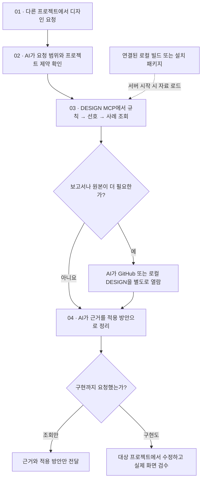

# 다른 프로젝트에서 DESIGN을 쓰는 흐름

**다른 프로젝트를 열고 그 채팅에서 요청합니다.** DESIGN MCP는 연결된 DESIGN 사본에서 필요한 근거를 찾아주고, 대상 프로젝트의 코드를 읽거나 바꾸는 일은 채팅의 AI가 별도로 합니다. 프로젝트마다 DESIGN 저장소를 복사할 필요는 없습니다.

**[인터랙티브 조회 지도](./design-pointer-map.html)**에서 정거장을 선택하면 핀이 `design` 연결 설정, MCP 조회, 저장소 우회로, 현재 프로젝트 복귀 경로를 따라 움직입니다. GitHub에서는 HTML을 내려받아 브라우저로 열면 됩니다. 지도 자체는 MCP를 호출하거나 파일을 수정하지 않습니다. 연결된 클라이언트에서는 `design://cross-project-workflow`에서 이 가이드를, `design://cross-project-workflow/map`에서 HTML을 읽을 수 있습니다.

## 요청 한 번이 지나가는 길



텍스트로 읽으면 **현재 프로젝트에서 요청 → 공통 규칙과 관련 근거 조회 → 필요할 때만 원문을 별도로 열람 → 조회는 설명으로, 구현은 대상 프로젝트의 수정·검수로** 이어집니다. 점선은 MCP가 연결된 사본에서 자료를 읽는 관계입니다. 조회할 때마다 GitHub를 동기화한다는 뜻은 아닙니다.

| 구분 | 하는 일 | 하는 일이 아닌 것 |
| --- | --- | --- |
| **DESIGN MCP** | 공통 규칙·취향·분석·시안·이식 지침을 읽기 전용으로 조회합니다. | 저장소 전체를 채팅에 불러오거나 대상 프로젝트를 직접 수정하지 않습니다. |
| **DESIGN 저장소** | 분석의 [원본 JSON](../content/analyses/), [생성 보고서](./analyses/README.md), 권한이 있는 시안 원문과 자산이 있는 곳입니다. | GitHub 페이지를 열거나 커밋을 푸시하는 것만으로 MCP의 데이터가 바뀌지는 않습니다. |
| **현재 프로젝트의 AI** | 요청에 맞는 근거를 골라 설명하고, 구현을 요청받았을 때만 대상 파일을 수정하고 검수합니다. | 원본 시안이나 자산 전체를 그대로 복제하지 않습니다. |

## 한 번 따라 하기: 전시 사이트에서 〈Moon〉 찾기

**전시 사이트 프로젝트를 연 채로** 이렇게 요청합니다.

> DESIGN MCP에서 고요하지만 고립감이 있는 전시 랜딩 레퍼런스를 찾아줘. 무엇을 유지하고 바꿔도 되는지, 모바일에서 무엇을 확인해야 하는지 근거와 함께 알려줘. 지금은 파일을 수정하지 마.

1. **규칙과 선호:** AI는 `design://design-cautions`를 먼저 읽고 `get_design_preferences`에서 관련 선호 근거를 확인합니다.
2. **검색:** `search_design_analyses`에서 아래처럼 분위기와 활용처를 함께 검색합니다. 제목을 이미 아는 경우에는 ID로 바로 상세를 확인할 수 있습니다.

   ```json
   {
     "scope": "preferred",
     "character": { "dimension": "mood", "query": "고요 고립감" },
     "useCase": "전시 랜딩"
   }
   ```

3. **근거 확인:** `get_design_analysis`에 `id: "pinterest-moon-concentric-poster"`를 주면 분석과 근거 목록, 활용 방안이 돌아옵니다. 인물 크기만 확인할 때는 `focus: "subject-composition.position-scale"`로 좁힙니다. 사람이 읽는 형태가 필요하면 [〈Moon〉 보고서](./analyses/pinterest-moon-concentric-poster.md#design-character)를 별도로 엽니다.
4. **답변:** “동심원과 우주인을 복제하지 말고, **화면 밖까지 이어지는 큰 구조와 작게 보이지만 알아볼 수 있는 전신 인물의 비율 차**를 가져오세요. 제목은 독립된 빈 면에 두고, 모바일에서는 인물·제목·예매 버튼이 각각 읽히는지 확인하세요.” 이 요청은 조회만이므로 파일을 수정하지 않습니다.

> 구현까지 요청했다면, 이 단계에서 현재 프로젝트의 레이아웃·컴포넌트·접근성 제약을 확인하고 시안의 원리를 옮깁니다. 실행 예제가 필요할 때만 `get_design_visual`에서 등록된 소스와 `sourceFiles`, 자산 권리를 확인합니다. 등록되지 않은 파일이나 참조 이미지가 필요하면 [공개 GitHub 저장소](https://github.com/acertainromance401/DESIGN), 접근 가능한 로컬 사본, 또는 보고서의 원출처를 별도로 엽니다. 로컬 전용 자료는 공개 저장소나 패키지에서 제공되지 않습니다.

## 새 프로젝트에서 연결과 최신 기록을 확인하는 법

| 상황 | 할 일 |
| --- | --- |
| **처음 연결한다** | AI가 실행되는 환경에서 Node.js 22 이상과 DESIGN 로컬 빌드 또는 설치 패키지를 준비합니다. 같은 환경의 여러 Copilot 프로젝트에서 쓸 때는 [연결 안내](./mcp-workflows.md#1-연결과-업데이트)에 따라 사용자 범위에 한 번 등록합니다. 다른 환경에서 실행되는 세션은 그 환경에서도 서버를 실행할 수 있어야 합니다. |
| **연결됐는지 확인한다** | 새 프로젝트의 채팅에서 `list_design_categories`를 호출해 보도록 요청합니다. 연결은 **조회할 수 있게 한다**는 뜻이지, 모든 디자인 요청에서 자동 조회된다는 뜻은 아닙니다. 반드시 참고해야 할 때는 요청에 “DESIGN MCP를 먼저 조회해”라고 씁니다. |
| **도구는 보이지만 새 기록이 없다** | 클라이언트가 어떤 사본을 실행하는지 확인합니다. 로컬 빌드는 해당 사본에 최신 데이터가 있어야 하고, 서버 코드가 바뀌었다면 다시 빌드합니다. 설치 패키지는 새 tarball로 교체합니다. 그 후 MCP 서버를 재시작합니다. GitHub에 푸시한 것만으로 실행 중인 서버는 갱신되지 않습니다. |
| **다른 프로젝트에서 찾은 참고를 축적한다** | [등록 절차](./recording-analyses.md)를 따라 DESIGN 소스의 분석 JSON을 갱신하고 문서를 생성한 뒤 MCP를 재시작합니다. DESIGN 소스에 쓰기 권한이 없다면 등록용 JSON을 전달합니다. 대화나 조회 결과가 저절로 저장되지는 않습니다. |
